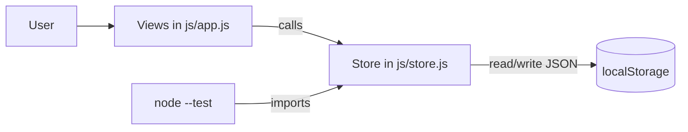
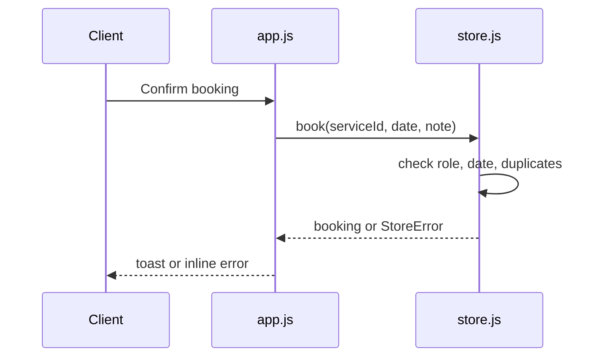

# Hourly: freelancer booking portal

A production-style capstone built with plain HTML, CSS and ES modules. No build step, no dependencies, deployable to any static host.

**Live demo:** _add your URL here after deploying (see Deployment)_

## Feature highlights

- **Simulated authentication:** sign up and log in as a *client* or *freelancer*. Passwords are salted and hashed with SHA-256 (Web Crypto) and sessions survive reloads. This is a demo; real apps need a server.
- **Interactive catalog:** live search, category filter and four sort orders.
- **Full CRUD:** freelancers create, edit and delete their own services. Ownership is enforced in the data layer, and deleting a service removes its bookings.
- **Booking flow:** clients book a date with a note, see their bookings and cancel them. Freelancers see incoming bookings. Past dates and duplicate bookings are rejected.
- **Persistent state:** everything is stored in `localStorage`. Corrupted data falls back to a clean seeded database instead of crashing.
- **Accessible by design:** skip link, labelled fields, keyboard-operable dialog, visible focus, live-region toasts, `prefers-reduced-motion` and dark mode support.
- **Safe rendering:** all content is inserted as text nodes (no `innerHTML`), plus a strict Content-Security-Policy on Vercel and Netlify.

## Architecture





```
.
├── index.html          single page shell
├── css/styles.css      design tokens, light and dark themes
├── js/store.js         data layer: auth, services, bookings (no DOM)
├── js/app.js           hash router and views
├── test/store.test.js  10 unit tests for the data layer
├── docs/               add screenshots here
├── vercel.json  netlify.toml  .github/workflows/pages.yml
└── package.json
```

**Boundaries:** `store.js` never touches the DOM and takes its storage as an argument, so it is unit-tested in Node with an in-memory shim. `app.js` never touches storage directly.

## Run locally

Requires Node 18+. ES modules need a web server, so opening `index.html` directly will not work.

```bash
npm test         # 10 unit tests
npm run serve    # http://localhost:8080
```

Try it: sign up as a freelancer, add a service, log out, sign up as a client, and book it.

## Deployment

Pick one. All three serve the repository root as static files.

- **GitHub Pages:** push to `main`, then in *Settings > Pages* set the source to *GitHub Actions*. The included workflow runs the tests, then deploys.
- **Vercel:** *Add New Project*, import the repo, framework preset *Other*, no build command. `vercel.json` adds security headers.
- **Netlify:** *Add new site > Import*, leave the build command empty, publish directory `.`. `netlify.toml` is picked up automatically.

Then paste the live URL at the top of this README.

## Limitations and next steps

Data lives in one browser, so there is no cross-device sync and no real security boundary. To go further, replace `store.js` with calls to an API and a database (the view layer needs no changes), and move authentication to a server with HTTP-only cookies.
